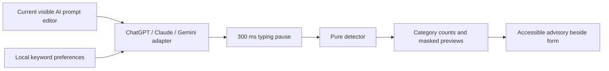
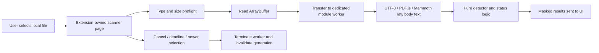

# Architecture and data flow

## Live draft

The manifest injects one bundled content entrypoint only on `https://chatgpt.com/*`, `https://claude.ai/*`, and `https://gemini.google.com/*`. `src/shared/sites.js` defines the exact origins; `src/content/adapters/` holds separate selectors and mounting anchors. The entrypoint selects an adapter by exact `location.origin`, so lookalikes and other services are rejected. `src/content/live-scanner.js` owns debounce, warnings, paste snapshots, storage preferences, and lifecycle for every service.

ChatGPT queries prompt id/test-id variants and Work-mode `data-composer-markdown`. Claude prioritizes chat-input markers, then labelled/fieldset ProseMirror and a legacy ProseMirror fallback excluding known message/artifact/dialog containers. Gemini queries `rich-textarea` Quill/role textboxes or native textareas, explicitly excluding `.ql-clipboard`, `user-query`, and `model-response`. No universal contenteditable/textarea selector is used. Native textarea values and contenteditable `innerText` are read only after a candidate passes the site's matching/exclusion rules.

Selectors are evaluated in priority tiers. A visible focused candidate wins; a sole visible candidate can be used without focus. Ambiguous candidates remain unread until one is focused. Hidden/inert/aria-hidden ancestors, hidden visibility, disabled/read-only inputs, and known historical/editor contexts are filtered before reading. If the composer disappears, the old advisory is removed. A MutationObserver handles replacement, visibility/marker changes, and SPA layouts. Input events cover typing and paste through one path. The adapter is a best-effort DOM contract: a site's future unmarked editors can still require an update. It never searches conversation text for a fallback draft.

A changed draft clears old draft findings immediately; an empty draft may still display a separate last-paste snapshot. After 300 ms, the same draft must remain connected/current before rendering. The advisory is a sibling below the full composer, never a child of its editable/scrolling area. Site-specific composer selectors and local send/stop controls identify the outer boundary; a rounded-card fallback handles older layouts. The shared mounting helper avoids body/main as composer containers and remounts when the site moves/replaces the composer or removes the advisory.

The closed shadow root resets inherited alignment/grid styling. A compact header, category chips, and × control remain visible; masked per-scope previews live in an expandable details element. The × has `aria-label="Dismiss warning"`, a focus indicator, and `type=button`; it hides the whole advisory and suppresses re-opening for the unchanged draft. Editing, pasting, or changed keywords enables review again. The status uses `aria-live=polite` and `aria-atomic=true`. Shadow DOM provides style separation, not a security boundary against the host site.

Passive capture listeners observe enabled, site-specific send-button clicks and composer form submissions. They clear the snapshot and current warning without cancelling events, changing sending, or modifying the draft. Stop controls and disabled sends are excluded. Enter is observed only for the active editor (not Shift/Alt+Enter, repeats, or IME composition). For up to two seconds, a cleared nonempty draft or a new visible Stop control confirms a keyboard send locally; an ordinary nonempty text change cancels the pending check. This also handles attachment-only sends via a new Stop control. The observations indicate UI activity, not network transmission or successful delivery. Custom send layouts without recognized controls/signals may require adapter updates.

The pure engine uses local formats and escaped literal keywords. Candidate priority and character occupancy resolve overlaps. Returned records contain category, UTF-16 offsets, and masked previews, never raw matched values. The live adapter holds its current draft only in JS memory until change/navigation; no draft or findings are stored.

A capture-phase paste handler reads only `text/plain` provided by a paste event targeting the supported active editor. It uses the same detector immediately, before the site may convert the text into an attachment and empty/replace the editor. A separate, labelled last-paste snapshot retains only masked groups and a partial flag. It neither polls the clipboard nor inspects attached files/chips. It clears on observed send actions, dismissal, another editor paste, keyword changes, or reload/close; attachment edits/removal are not tracked. Draft and paste counts are separate views, not additive totals. The handler never prevents default paste, stops propagation, modifies clipboard contents, or changes sending. Paste text is capped at 2,000,000 characters with explicit partial status; raw clipboard text is not retained after the event handler returns.

## Document scan

Every selection increments a generation and terminates the previous worker. Responses must match the current generation. The UI deadline begins before file reading so synchronous parser work in a worker remains terminable. File buffers are transferred, not cloned. PDF.js may create a child worker; normal completion destroys its loading task, and terminating its parent processing worker ends its owned child workers. Only masked findings and status/page metadata leave the worker. Errors map to static reasons, including separate password rejection for PDFs; raw parser diagnostics are not displayed or logged.

PDF.js, its worker, CMaps, and standard fonts are packaged locally. Mammoth's browser build is bundled and only `extractRawText` is called; document HTML is never rendered. Invalid UTF-8 or NUL-containing TXT/CSV is rejected. CSV formulas remain inert text.

Character/page caps produce partial coverage. No non-whitespace extracted text means Not scanned. Successful body text extraction does not claim image/comment/metadata coverage. The worker terminates after a result. The selected File remains in the picker until Clear results, a new selection, or page close. Clear cancels work, resets the picker, and removes findings. GC eventually reclaims buffers/text; no secure memory-erasure guarantee is made.

## Permissions and persistence

`storage` is the sole explicit API permission. Content-script matches grant site access to exactly the ChatGPT, Claude, and Gemini HTTPS origins, not all sites, subdomains, or all Google properties. There are no broad host permissions, tab-reading permissions, activeTab, scripting permissions, web-accessible resources, or externally connectable message handlers. Injection is top-frame only. The toolbar service worker uses `chrome.tabs.create`, which does not need tab-reading permission. File input selection is explicit browser-mediated input, not filesystem access permission.

Only `{ keywords: [...] }` is stored in `chrome.storage.local`, never sync storage. One keyword list applies across all three sites and file scans. Limits are session-only. Prompts, file names, files, extracted text, detected values, masked results, timestamps, and scan history are not persisted. There are no runtime HTTP APIs, remote scripts, analytics, or cloud AI calls. CSP restricts extension scripts/workers/connections to packaged resources. It does not govern the AI websites' own scripts or traffic.

The toolbar action sends a `promptprivacy:status` message to the clicked tab without adding permissions. The content script returns only the static state `editor-found` or `editor-not-found` and an allowlisted service id (`chatgpt`, `claude`, `gemini`); no receiver means `not-connected`. Whitelisted values populate the scanner heading and troubleshooting text through safe text rendering. Unknown ids are ignored. No draft, category, count, tab URL, or DOM contents are included in the response. This is a connection check at click time, not a guarantee of every live layout's compatibility.
