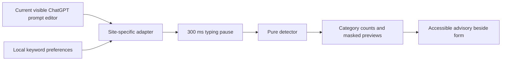
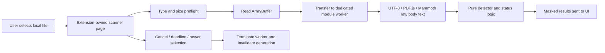

# Architecture and data flow

## Live draft

The manifest injects a bundled content script only on `https://chatgpt.com/*`. It queries explicit `#prompt-textarea` contenteditable/textarea and data-testid variants, plus Work-mode `[contenteditable="true"][role="textbox"][data-composer-markdown]` editors observed in the user's live DOM. It prioritizes a focused matching editor and otherwise chooses the last visible candidate. It does not match generic textboxes or all ProseMirror editors. A MutationObserver handles editor replacement, contenteditable/marker changes, and SPA layout changes. Input events cover typing and paste through one path. Conversation history, attachments, and other fields are never read. Observing DOM changes only triggers editor discovery/current-draft reads.

A changed draft clears old findings immediately. Empty drafts have no advisory. After 300 ms, the same draft must remain connected/current before rendering. The advisory sits outside the form in a closed shadow root with `role=status`, `aria-live=polite`, and masked text. It installs no submit/key/click/paste prevention handlers and has no send-button hooks. Shadow DOM provides style separation, not a security boundary against the host page. Selector/visibility/placement assumptions are compatibility risks.

The pure engine uses local formats and escaped literal keywords. Candidate priority and character occupancy resolve overlaps. Returned records contain category, UTF-16 offsets, and masked previews, never raw matched values. The live adapter holds its current draft only in JS memory until change/navigation; no draft or findings are stored.

A capture-phase paste handler reads only `text/plain` provided by a paste event targeting the supported active editor. It uses the same detector immediately, before the site may convert the text into an attachment and empty/replace the editor. A separate, explicitly labelled last-paste snapshot retains only masked groups and a partial-coverage flag. It neither reads clipboard contents in the background nor inspects attached files/chips. The snapshot does not assert the attachment is still present or unchanged, and remains until dismissed, another editor paste, keyword changes, or page reload/close. Counts for the current draft and last paste are separate views, not additive totals. The handler never prevents default paste, stops propagation, modifies clipboard contents, or changes sending. Paste text is capped at 2,000,000 characters with explicit partial status; raw clipboard text is not retained by the extension after the handler returns.

## Document scan

Every selection increments a generation and terminates the previous worker. Responses must match the current generation. The UI deadline begins before file reading so synchronous parser work in a worker remains terminable. File buffers are transferred, not cloned. PDF.js may create a child worker; normal completion destroys its loading task, and terminating its parent processing worker ends its owned child workers. Only masked findings and status/page metadata leave the worker. Errors map to static reasons, including separate password rejection for PDFs; raw parser diagnostics are not displayed or logged.

PDF.js, its worker, CMaps, and standard fonts are packaged locally. Mammoth's browser build is bundled and only `extractRawText` is called; document HTML is never rendered. Invalid UTF-8 or NUL-containing TXT/CSV is rejected. CSV formulas remain inert text.

Character/page caps produce partial coverage. No non-whitespace extracted text means Not scanned. Successful body text extraction does not claim image/comment/metadata coverage. The worker terminates after a result. The selected File remains in the picker until Clear results, a new selection, or page close. Clear cancels work, resets the picker, and removes findings. GC eventually reclaims buffers/text; no secure memory-erasure guarantee is made.

## Permissions and persistence

`storage` is the sole explicit API permission. The content-script match covers only ChatGPT; there are no broad host permissions, tab-reading permissions, activeTab, scripting permissions, web-accessible resources, or externally connectable message handlers. The toolbar service worker uses `chrome.tabs.create`, which does not need tab-reading permission. File input selection is explicit browser-mediated input, not filesystem access permission.

Only `{ keywords: [...] }` is stored in `chrome.storage.local`, never sync storage. Limits are session-only. Prompts, file names, files, extracted text, detected values, masked results, timestamps, and scan history are not persisted. There are no runtime HTTP APIs, remote scripts, analytics, or cloud AI calls. CSP restricts extension scripts/workers/connections to packaged resources. It does not govern ChatGPT's own scripts or traffic.

The toolbar action sends a `promptprivacy:status` message to the clicked tab without adding permissions. The content script returns only the static state `editor-found` or `editor-not-found`; no receiver means `not-connected`. A whitelisted state is passed to the scanner page to show troubleshooting instructions. No draft, category, count, URL, or DOM contents are included in the response. This is a connection check at the time of the click, not a guarantee of live-site compatibility.
